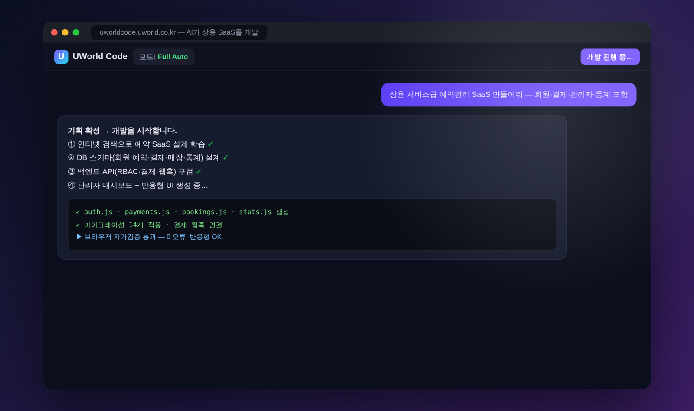
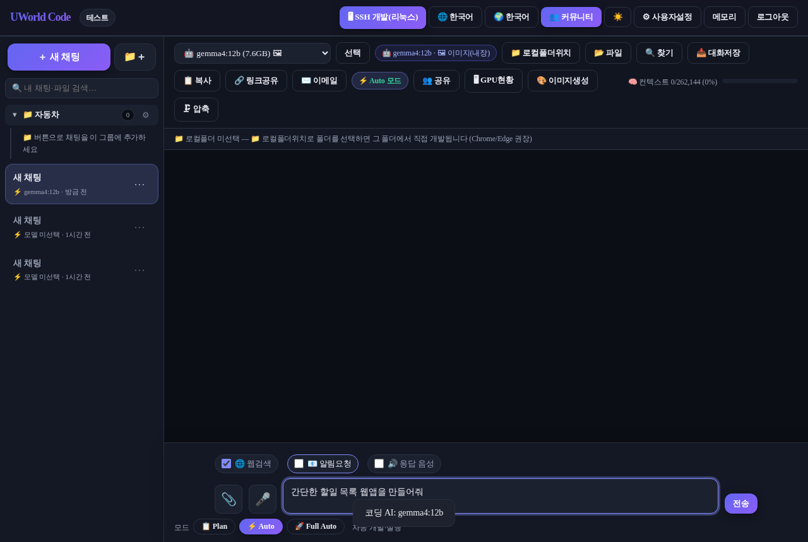
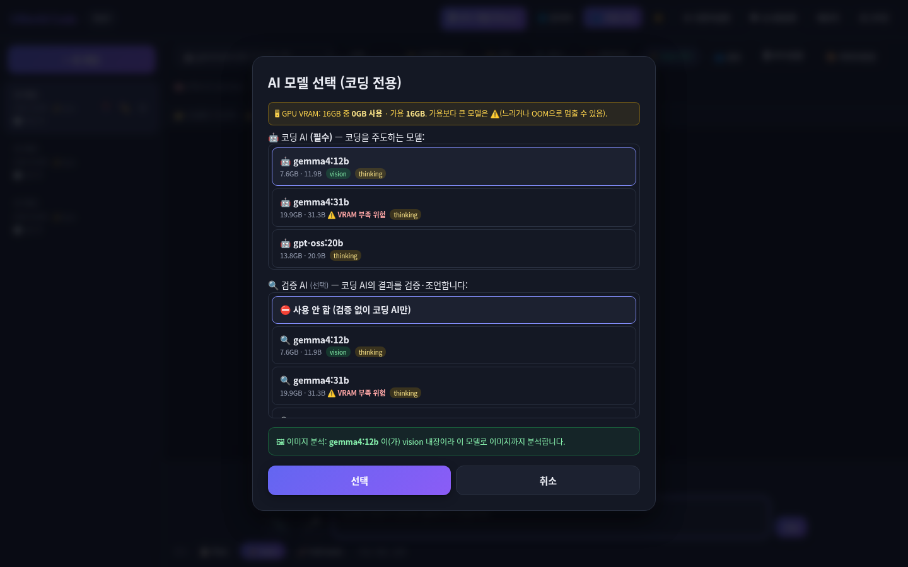

<div align="center">

# UWorld Code · 유월드 코드

**Say it. It gets built. — A self-hosted AI coding agent that runs on your own PC.**
**말하면, 만들어집니다. — 내 PC에서 돌아가는 자체 호스팅 AI 코딩 에이전트.**

[](https://github.com/UWorld-Group/uworldcode/releases/latest)
[](https://github.com/UWorld-Group/uworldcode/releases)

| Windows | macOS |
|:---:|:---:|
| [**Download**](https://github.com/UWorld-Group/uworldcode/releases/latest) | [**DMG (Apple silicon)**](https://github.com/UWorld-Group/uworldcode/releases/latest) |

</div>

## Screenshots · 화면

<p align="center">
  
</p>
<p align="center">
  
  
</p>

---

## Why UWorld Code · 왜 유월드 코드인가

UWorld Code turns a single chat message into a working project. Describe what you want in plain language, and its AI coding agent plans the work, designs the database, writes the backend and frontend, checks the result in a real browser, and keeps going until it works.

Everything runs on **your own machine**. The AI models, the database and your projects stay on your PC, so your ideas and your code never have to leave it. You choose which AI models to use, and you can work offline once the models are downloaded.

유월드 코드는 채팅 한 줄을 실제로 동작하는 프로젝트로 바꿔 줍니다. 만들고 싶은 것을 우리말로 적으면, AI 코딩 에이전트가 기획하고, DB를 설계하고, 백엔드와 화면을 만들고, 실제 브라우저로 결과를 확인하면서 될 때까지 이어서 작업합니다.

모든 것이 **내 PC에서** 돌아갑니다. AI 모델·데이터베이스·프로젝트가 내 컴퓨터 안에 있으므로 아이디어와 코드가 밖으로 나가지 않습니다. 사용할 AI 모델을 직접 고를 수 있고, 모델을 내려받은 뒤에는 인터넷 없이도 작업할 수 있습니다.

## Features · 주요 기능

### 🚀 Three autonomous modes · 세 가지 자율 모드
- **Plan · Auto · Full Auto** — Review a plan first, let it work step by step, or hand over the whole job.
  계획을 먼저 확인하거나, 단계별로 맡기거나, 처음부터 끝까지 통째로 맡길 수 있습니다.

### 🧠 Your own AI, on your own PC · 내 PC의 내 AI
- Pick a coding AI and an optional reviewer AI. GPU memory is checked before you choose, and idle models give their memory back automatically.
  코딩 AI와 (선택) 검증 AI를 고릅니다. 고르기 전에 GPU 메모리 여유를 보여 주고, 쉬는 모델은 메모리를 자동으로 돌려줍니다.

### 📐 Production-ready by default · 처음부터 상용 기준
- Hundreds of development guidelines are applied to every request — sign-up and roles, payments, multi-tenancy, security and legal pages are planned from the start.
  요청마다 수백 개의 개발 지침이 자동 적용되어 회원·권한·결제·멀티테넌시·보안·약관까지 처음부터 함께 설계합니다.

### 🌐 Learns from the live web · 실시간 검색으로 최신 기술
- Searches the internet while it works, so it uses current libraries and practices.
  작업 중 인터넷을 검색해 최신 라이브러리와 방법을 반영합니다.

### 🖥️ Built-in tools · 기본으로 들어 있는 도구
- SSH development terminal, local-folder development, file search, image generation and editing, and speech-to-text.
  SSH 개발 터미널, 내 PC 폴더에서 바로 개발, 파일 찾기, 이미지 생성·편집, 음성 입력(STT)을 지원합니다.

### 📱 Use your PC's AI from your phone · 휴대폰에서 PC의 AI 사용
- Connect a phone on the same network with a 6-digit code or QR code, then use the PC's AI for chat, translation and speech-to-text.
  같은 네트워크의 휴대폰을 6자리 코드나 QR로 연결해 PC의 AI로 대화·번역·음성 인식을 할 수 있습니다.

### 🔄 Updates itself safely · 안전한 업데이트
- Updates are prepared in a separate folder first, and applied only after you approve, with a backup.
  업데이트는 별도 폴더에서 먼저 준비하고, 승인한 뒤 백업과 함께 반영합니다.

---

## Install · 설치 안내

### Windows

**Requirements · 사양**: Windows 10 / 11 (64-bit), 16 GB RAM or more recommended, an NVIDIA GPU with 8 GB+ VRAM recommended for local AI, about 10 GB of free disk space (more for AI models).
권장 사양: Windows 10/11 64비트, 메모리 16GB 이상, 로컬 AI용 NVIDIA GPU(VRAM 8GB 이상), 디스크 여유 약 10GB(AI 모델은 별도).

1. Download **`UWorldCode-<version>-windows-x64-setup.exe`** from the [latest release](https://github.com/UWorld-Group/uworldcode/releases/latest).
   [최신 릴리스](https://github.com/UWorld-Group/uworldcode/releases/latest)에서 설치 파일을 내려받습니다.
2. Run it and follow the installer. You create the first administrator account during setup. The installer is code-signed by **유월드 (UWorld)**.
   실행해 설치를 진행합니다. 설치 중에 첫 관리자 계정을 만듭니다. 설치 파일은 "유월드" 이름으로 서명되어 있습니다.
3. Open **UWorld Code** from the Start menu and sign in. Then pick your AI models and start a new chat.
   시작 메뉴에서 **UWorld Code**를 열어 로그인한 뒤, AI 모델을 고르고 새 채팅을 시작합니다.
4. *(Optional)* Verify the file with `SHA256SUMS.txt` from the same release:
   *(선택)* 같은 릴리스의 `SHA256SUMS.txt` 로 파일이 변조되지 않았는지 확인할 수 있습니다.
   ```powershell
   Get-FileHash .\UWorldCode-<version>-windows-x64-setup.exe -Algorithm SHA256
   ```

### macOS (DMG)

**Requirements · 사양**: a Mac with Apple silicon (M1 or later), 16 GB unified memory or more recommended.
권장 사양: Apple 실리콘(M1 이상) Mac, 통합 메모리 16GB 이상.

1. Download **`UWorldCode-<version>-macos-arm64.dmg`** from the [latest release](https://github.com/UWorld-Group/uworldcode/releases/latest) and open it.
   최신 릴리스에서 DMG를 내려받아 엽니다.
2. Drag **UWorld Code** onto **Applications**. The app is signed with UWorld's Developer ID and **notarized by Apple**.
   **UWorld Code**를 응용 프로그램 폴더로 끌어다 놓습니다. 유월드 Developer ID 서명과 Apple 공증을 받은 앱입니다.
3. Open it from Applications and follow the first-run setup.
   응용 프로그램에서 실행해 처음 설정을 진행합니다.
4. *(Optional)* Verify: `shasum -a 256 UWorldCode-<version>-macos-arm64.dmg`

---

## About this repository · 이 저장소에 대해

This repository is used **only to distribute installers**. The source code is not published here.
The "Source code" archives that GitHub attaches to every release contain only this README, the license and the screenshots.

이 저장소는 **설치 파일 배포 전용**입니다. 앱 소스코드는 공개하지 않으며, 릴리스마다 GitHub가 자동으로 붙이는 "Source code" 압축 파일에는 이 안내문·사용권 안내·화면 이미지만 들어 있습니다.

## Support · 문의

- Website · 웹사이트: https://service.uworld.co.kr
- Install & user guide · 설치·사용법: https://service.uworld.co.kr/install/uworldcode

<div align="center">

Part of **[UWorld Group](https://github.com/UWorld-Group)** · See [LICENSE.txt](LICENSE.txt) · © UWorld. All rights reserved.

</div>
